# Shurokkha Seba Sylhet (সুরক্ষা সেবা সিলেট)

**COVID-19 Testing Management System** – a web application that lets people in Sylhet book a COVID-19 test online and receive their result within 24 hours, with home-based sample collection.

B.Sc. final-year project, Department of Computer Science & Engineering, Metropolitan University, Sylhet (submitted August 2023).

- **Team:** Samia Rahman Rima and Tusty Rani Dhar (Batch 47A)
- **Supervisor:** Md. Mushtaq Shahriyar Rafee, Department of CSE, Metropolitan University, Sylhet

## Motivation

The project was inspired by the Bangladesh government's Surokkha COVID-19 website. During the pandemic, people who were already unwell had to wait in long queues outside testing centres. Shurokkha Seba Sylhet proposes a home-based alternative: patients book online, and staff visit their homes to collect a sample.

## Features

**Guest**
- Information pages about COVID-19: symptoms, prevention, doctors, news, and vaccine registration

**User (patient)**
- Registration with email verification, login, and forgot-password (reset by email)
- Test booking form: personal details, NID, blood group, address and ward, vaccination, and previous infection history
- Result lookup by NID
- Plasma donor list
- View and edit profile, upload profile image, change password

**Admin**
- Separate admin login
- Dashboard with totals: registered users, test bookings, admins
- Appointments table with edit and delete
- Update test status through five phases: sample collection date announced → test date and time → sample collected → sample being tested → result (Positive / Negative)
- Admin profile

## Tech Stack

| Layer | Technology |
|---|---|
| Frontend | HTML5, CSS3, Bootstrap 5, JavaScript, Blade templates |
| Backend | PHP, Laravel 8 |
| Database | MySQL |
| Tools | Visual Studio Code, XAMPP, Composer, npm (Laravel Mix) |

The interface is in Bangla.

## Screenshots

### Home (guest)
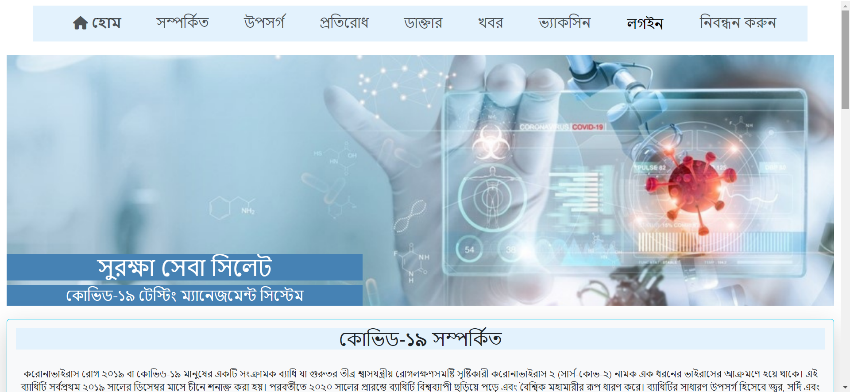

| Symptoms | Prevention |
|---|---|
| 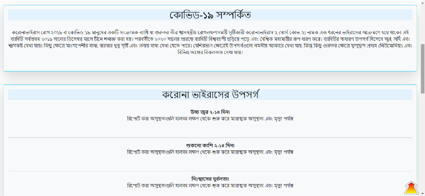 | 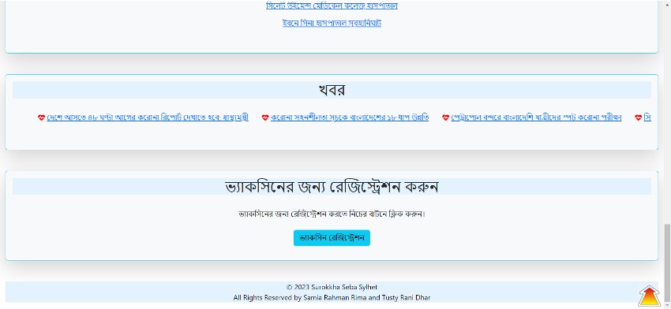 |

### Registration and login
| Register | Login |
|---|---|
| 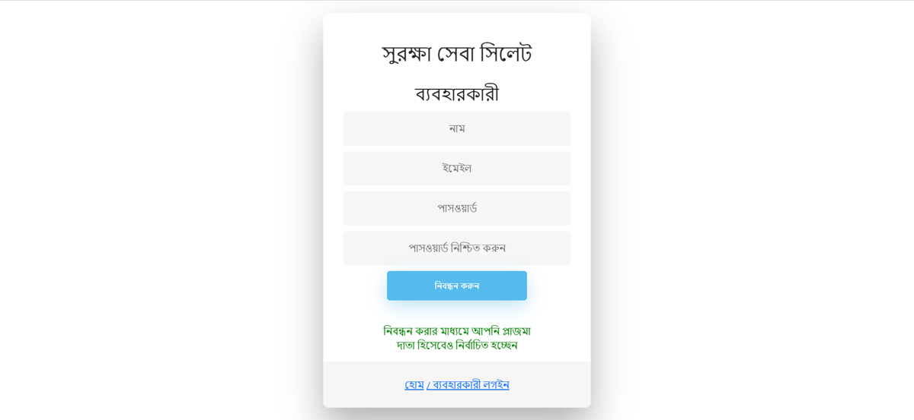 | 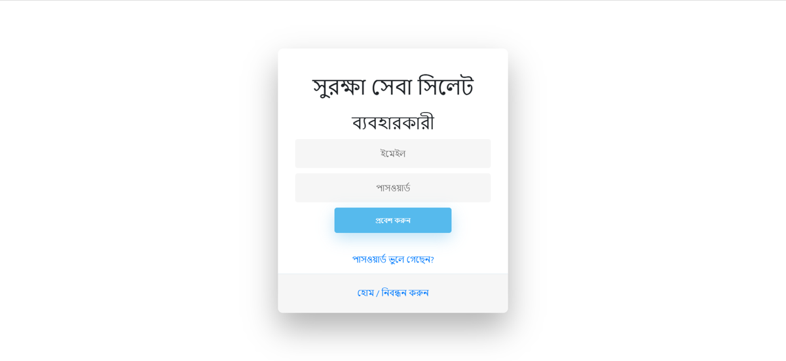 |

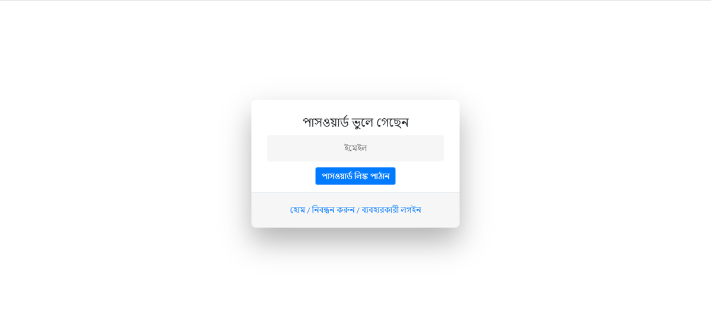

### User dashboard
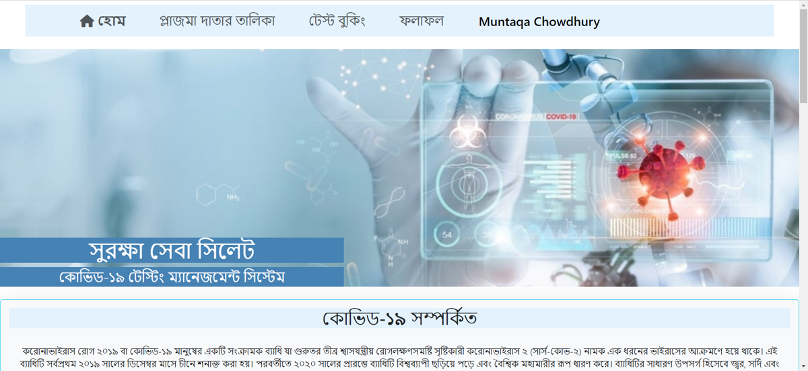

| Test booking | Result search |
|---|---|
| 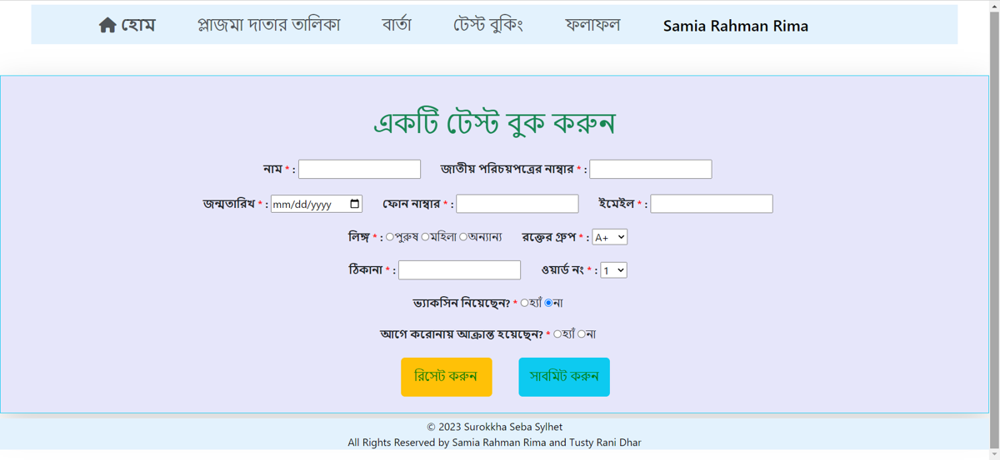 | 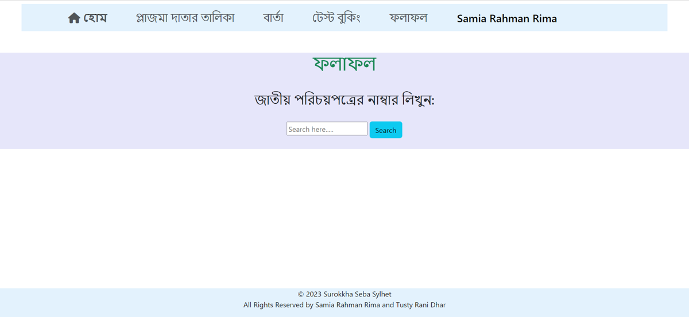 |

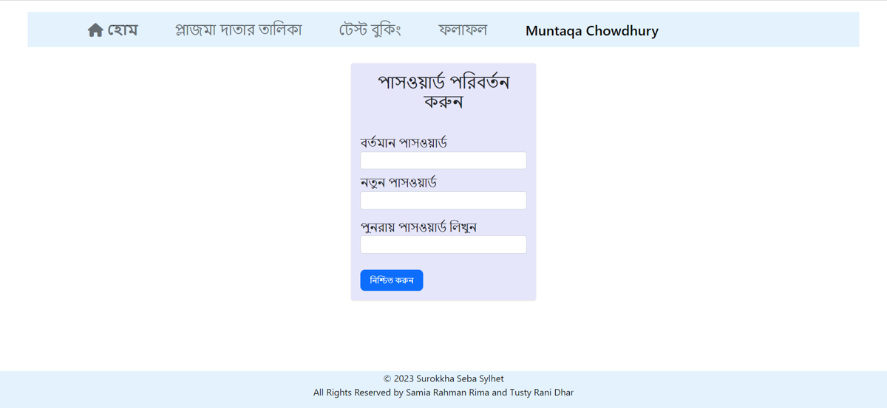

### Admin
| Admin login | Dashboard |
|---|---|
| 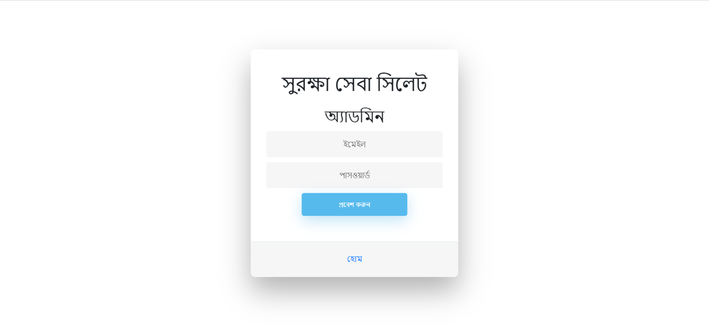 | 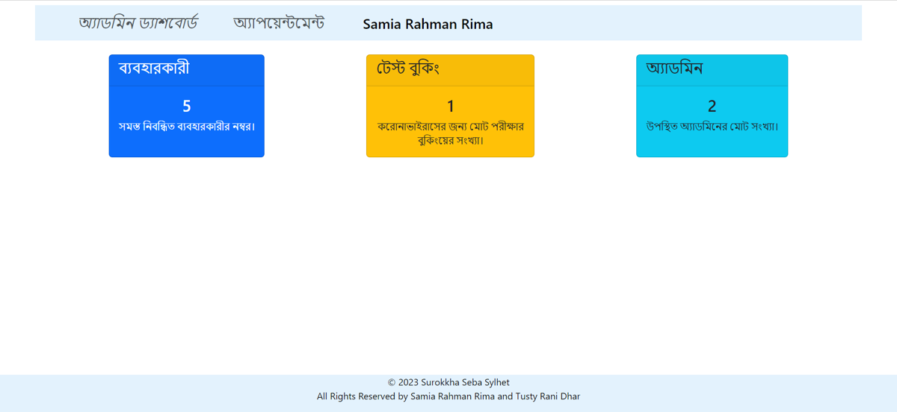 |

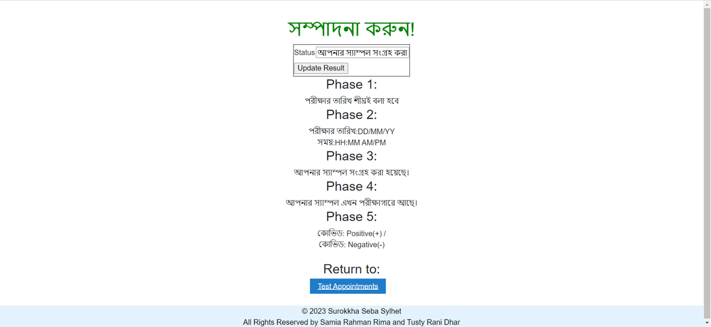

## Getting Started

### Prerequisites

- PHP 7.4 or 8.x and Composer
- Node.js and npm
- MySQL (or XAMPP)

### Installation

```bash
git clone https://github.com/rahman-rima/shurokkha_seba_sylhet.git
cd shurokkha_seba_sylhet

composer install
npm install

cp .env.example .env
php artisan key:generate
```

Open `.env` and set your database and mail details:

```
DB_DATABASE=your_database_name
DB_USERNAME=root
DB_PASSWORD=

MAIL_MAILER=smtp
MAIL_HOST=smtp.gmail.com
MAIL_PORT=587
MAIL_USERNAME=your_email
MAIL_PASSWORD=your_app_password
```

Email verification and password reset need working mail settings.

```bash
# Create an empty MySQL database with the name above, then:
php artisan migrate

npm run dev
php artisan serve
```

Open http://127.0.0.1:8000 in your browser.

> Admin accounts are not created through registration. They are set in the database by the database administrator. 

## Future Work

- Android app version
- Blood donation feature and live doctor appointments
- Live chat support for visitors
- Email option for admins to message users

## Authors

- **Samia Rahman Rima** – samiarahmanrimaa@gmail.com
- **Tusty Rani Dhar**

## Acknowledgements

Supervised by Md. Mushtaq Shahriyar Rafee, Metropolitan University, Sylhet.
